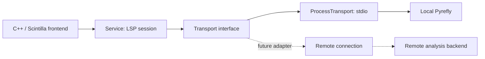

# Frontend/backend language-service boundary

The Windows frontend now talks to a transport-independent LSP session. The
current product connects that session to the existing local Pyrefly stdio
process. This change prepares the common interface for remote analysis; it
does not configure or connect any remote server. No network/SSH/TLS connector,
server deployment, authentication UI or automatic project synchronization is
included in this stage.



## Interface responsibilities

| Component | Responsibility |
| --- | --- |
| `workbench_language.cpp` | Frontend editor, local document identity, carets, undo and popups. It chooses a transport and backend profile. |
| `Service` | LSP initialization, document versions, incremental synchronization, requests, cancellation, capability checks and diagnostics. No Win32/process/filesystem APIs. |
| `Transport` | Nonblocking `send`, event `drain`, wake notification and owned connection lifetime. The host injects an implementation. |
| `ProcessTransport` | Existing Windows hidden process, bounded stdio queues, framing and job-owned worker cleanup. |
| `WorkspaceUris` | Relative frontend names ↔ backend file URIs, independent of the local filesystem. Supports POSIX, Windows drive and UNC roots. |
| `pyreflySession` | Backend-specific language ID, interpreter and configuration. Pyrefly settings are outside the generic session. |

`protocol`, `workspace_uri`, `transport`, `service` and `backend` form a standalone
C++20 core. The `--language-core-test` build compiles those sources without the
Windows process adapter, GUI libraries, Scintilla or a Pyrefly executable. This
target was checked with MSVC on Windows x64; Linux compiler/runtime validation
has not been performed.

## Session configuration

`SessionOptions` describes the backend's view of the workspace:

- `rootUri`: absolute file URI on the **backend machine**, e.g.
  `file:///srv/project` rather than the frontend's `C:/Projects/project`.
- `workspaceName` and `languageId`: LSP folder name and document language.
- `initializationOptions` and `settings`: backend-owned JSON configuration.
  `workspace/configuration` resolves dotted sections from `settings`.
- `parentProcessId`: optional. Supply the frontend PID for a backend on the same
  machine; leave it unset (`null` on the wire) across machine/process namespaces.
- `serverName`: display label, independent of the transport implementation.

For example, a future host with a configured remote transport can construct:

```cpp
auto session = pyreflySession("file:///srv/project", "Project",
                             "/srv/project/.venv/bin/python");
service.start(std::move(remoteTransport), std::move(session), wakeHost);
```

`remoteTransport` in this example must be supplied by the future connection
module; no placeholder that pretends to establish a connection is shipped.
Existing production wiring instead injects `ProcessTransport` and supplies the
local interpreter, workspace URI and frontend PID.

## Wire and lifetime contract

The wire contract is [LSP 3.17 JSON-RPC](https://microsoft.github.io/language-server-protocol/specifications/lsp/3.17/specification/).
Stream transports reuse the existing `Content-Length` framing/decoder. An
adapter must bound queues/messages, keep connection/I/O work off the UI thread,
and deliver `Connected`, `Message` and `Disconnected` events in order. `Connected`
starts LSP initialization, not editor readiness. A transport's optional
`processId()` is local telemetry; it is not used to infer the server's parent PID.

The host calls `Service` and the interface on one thread. `send()` enqueues and
returns without waiting for analysis. The wake callback only signals the host
(the Windows adapter posts a message); it must not call editor/session methods.
`stop()` joins/cleans workers and guarantees no later callbacks. The session owns
its transport and stops it before destruction or replacement. Reconnection uses
a new transport and reopens document snapshots. Disconnection keeps editor text
available while analysis becomes unavailable.

The existing local adapter retains its 16 MiB queue/body budgets and capped
event counts. Future adapters must enforce equivalent bounds and use an
authenticated, encrypted connection appropriate to their deployment. No public
plaintext listener or connection credentials are introduced by this change.

## Document identity and project files

The frontend uses project-relative names such as `src/main.py`; they stay in
results returned to the editor. `WorkspaceUris` maps those names to backend URIs,
then maps diagnostic URIs back before looking up an opened document. It rejects
absolute/parent frontend paths, URI parent traversal and diagnostics outside the
configured backend root. Windows roots compare ASCII case insensitively; POSIX
roots compare case sensitively. Relative filename spelling is preserved.

Text and carets use UTF-8 bytes in the editor and negotiated UTF-16 positions on
the wire. Versions, cancellation and stale-response checks apply equally to
injected transports. Unsaved **opened** document contents flow through LSP;
unopened project files, imported modules and dependencies must already be
available to a future backend. Repository sync, remote filesystem access,
environment installation, remote execution/debugging and real network latency
testing remain separate work. This interface refactor does not upload a project.

## Validation

Run `build.cmd --language-core-test` for 24 independent contract checks using a
scripted in-memory endpoint. They cover Linux/Windows/UNC/Unicode URI mapping,
workspace boundaries, remote initialization with a null parent PID, backend
interpreter configuration, incremental edits, UTF-16 positions, diagnostics,
cancellation, old versions, configuration sections and disconnection. These
checks are also included in `--language-test`, alongside the 47 existing real
Pyrefly/native-editor checks. Simulated endpoints do not establish real remote
connectivity, authentication, filesystem synchronization or production readiness.
